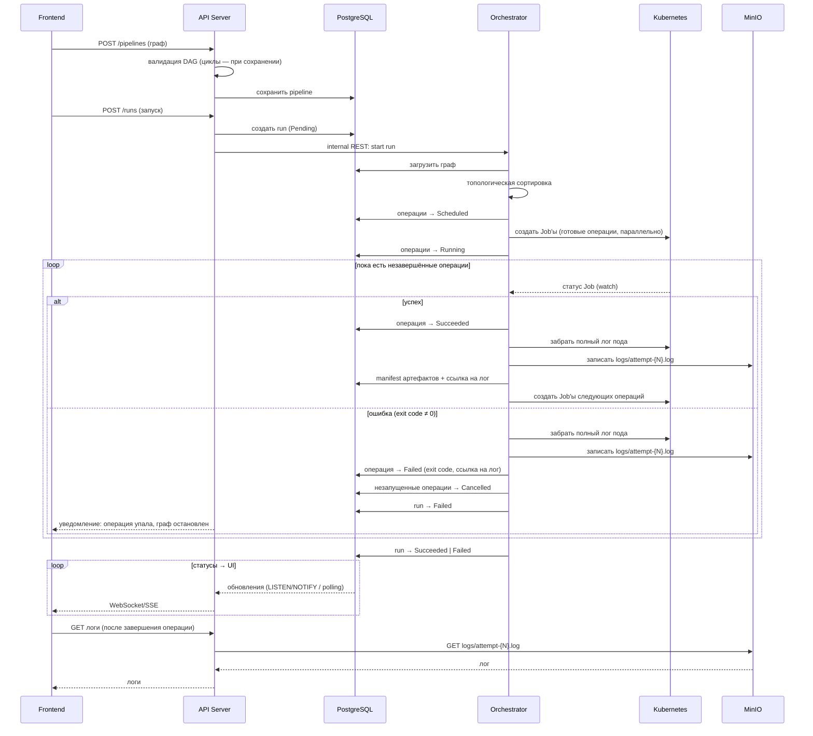
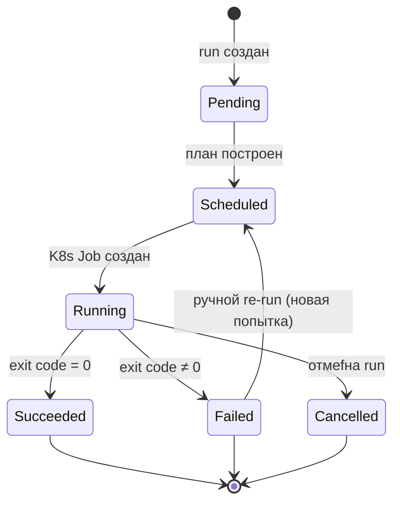

# Архитектура платформы

Платформа для описания и выполнения вычислительных pipeline в виде ориентированного графа (DAG) с запуском операций на Kubernetes.

## 1. Общая карта компонентов

Границы между сервисами:

- **API Server** — синхронный сервис «для UI»: CRUD, валидация, отдача статусов. Не знает про Kubernetes.
- **Orchestrator** — фоновый сервис с watch-циклом. **Единственная точка доступа к Kubernetes**: создание Job, watch, сбор логов. API проксирует запросы логов UI через него.
- **PostgreSQL — источник истины по статусам.** Orchestrator пишет статусы в БД, API читает их (LISTEN/NOTIFY или polling) и раздаёт в UI через WebSocket/SSE. Рестарт любого из сервисов не теряет состояние.
- **Логи всегда из MinIO**: Orchestrator записывает лог один раз — по завершении операции (полный лог пода через K8s API); API отдаёт логи из MinIO после терминального статуса, во время выполнения логов нет (детали в разделе 6).
- Запуск/отмена — внутренний REST-вызов API → Orchestrator. Альтернатива без прямого вызова: Orchestrator сам забирает новые run'ы из БД (polling) — тогда связность ещё ниже, но задержка старта выше.

## 2. Жизненный цикл запуска pipeline

## 3. Машина состояний операции

Единая модель статусов для БД, Kubernetes и UI.

Семантика ошибок:

- **Автоматических retry нет.** Ошибка пользовательского кода (exit code ≠ 0) → операция сразу `Failed`, исполнение графа останавливается.
- При этом незапущенные операции графа переводятся в `Cancelled`, run — в `Failed`; пользователь получает статус (WebSocket/SSE) и логи упавшей операции — этого достаточно, чтобы понять причину.
- **Единственный способ повторить — ручной re-run** узла (после исправления): операция возвращается в `Scheduled`, начинается новая попытка.
- Инфраструктурные сбои платформы (рестарт API/Orchestrator) статусов не меняют — состояние восстанавливается из БД (reconcile).
- K8s Job создаётся с `backoffLimit: 0` и `restartPolicy: Never` — один под на попытку, чтобы Kubernetes не делал скрытых ретраитов за нашей спиной.

## License

Проект распространяется под лицензией [Apache License 2.0](LICENSE).
