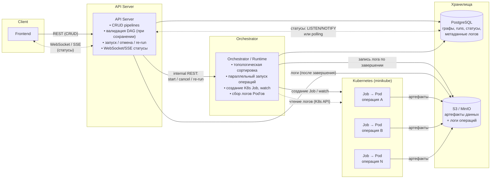
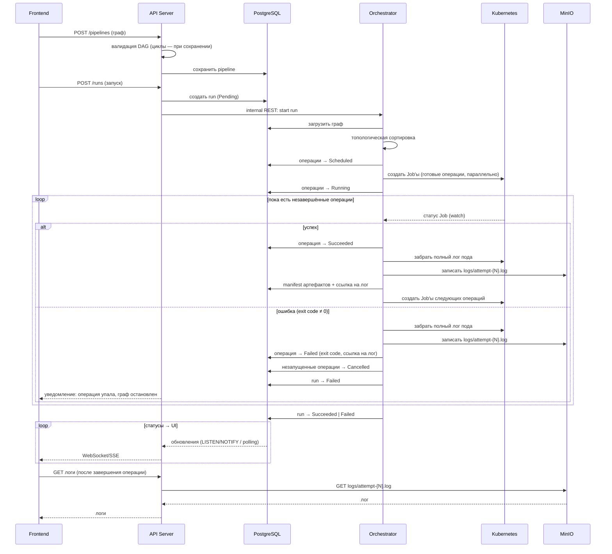
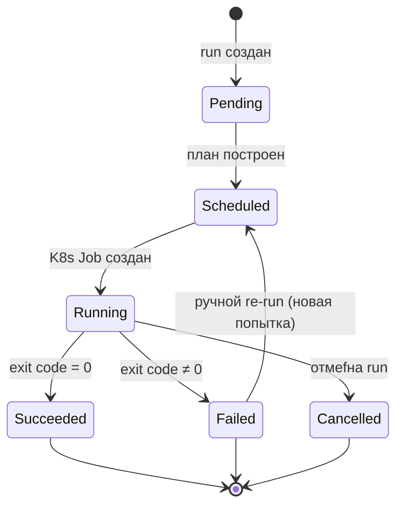

# p-graph

> Платформа для описания и выполнения вычислительных pipeline в виде ориентированного графа (DAG) с запуском операций на Kubernetes.

[](LICENSE)
[](https://go.dev)
[](https://react.dev)
[](https://minikube.sigs.k8s.io)
[](https://www.postgresql.org)
[](https://min.io)

## Общая карта компонентов



## Структура репозитория

Монорепозиторий: Go-модуль в корне, инфраструктура — `deploy/`. Пустые каталоги каркаса содержат `.gitkeep` (git не трекает пустые директории) — файлы удаляются по мере появления кода.

```
p-graph/
├── cmd/                        # точки входа (по сервису на каталог)
│   ├── apiserver/              #   API Server: REST + WebSocket/SSE
│   └── orchestrator/           #   Orchestrator: планировщик, K8s watch
├── internal/
│   ├── model/                  # доменные типы: Pipeline, Run, Operation, статусы
│   ├── api/                    # HTTP-хендлеры API Server
│   ├── orchestrator/           # ядро исполнения: планирование run'ов
│   ├── storage/                # PostgreSQL: доступ к данным
│   ├── migrator/               # применение миграций БД
│   ├── artifacts/              # S3/MinIO клиент: artifacts/{run_id}/{node_id}, логи
│   └── k8s/                    # создание Job, watch, сбор логов Pod'ов
├── migrations/                 # SQL-миграции, схема БД меняется только через них
├── deploy/
│   ├── docker/                 # Dockerfiles сервисов
│   └── k8s/                    # манифесты кластера: каталог = приложение
│       ├── postgres/           #   БД (deployment, service, pvc)
│       ├── minio/              #   S3-хранилище (deployment, service, ingress)
│       ├── apiserver/          #   API Server (deployment, service, ingress)
│       ├── orchestrator/       #   Orchestrator (deployment, service, rbac)
│       └── argo/               #   Argo (ingress, configmap)
├── go.mod                      # module github.com/AnarCom/p-graph
├── CLAUDE.md                   # соглашения проекта
├── LICENSE                     # Apache License 2.0
└── README.md
```

## Локальный запуск (minikube)

Требуется: [minikube](https://minikube.sigs.k8s.io/docs/start/), `kubectl`, драйвер docker.

```bash
# 1. Поднять кластер с ingress-контроллером (один раз)
minikube start --driver=docker
minikube addons enable ingress

# 2. Собрать образ apiserver и загрузить его в minikube
docker build -f deploy/docker/apiserver/Dockerfile -t pgraph-apiserver:v1 .
minikube image load pgraph-apiserver:v1

# 3. Применить все манифесты (namespace pgraph)
kubectl apply -k deploy/k8s

# 4. Проверить, что всё поднялось
kubectl get pods -n pgraph

# 5. Подключиться к PostgreSQL (порт кластера напрямую недоступен на macOS)
kubectl port-forward svc/postgres 5432:5432 -n pgraph
psql -h 127.0.0.1 -U pgraph -d pgraph

# 6. Для доступа к консоли minio
echo "127.0.0.1 minio.local" | sudo tee -a /etc/hosts > /dev/null # добавляем локальную DNS запись
sudo minikube tunnel
curl http://minio.local

# 7. Для доступа к argo
echo "127.0.0.1 minio.local" | sudo tee -a /etc/hosts > /dev/null
curl http://argo.local

# 8. Чтобы запустить workflow
создать argo-bucket
в argo интерфейсе запустить workflow
```

## Жизненный цикл запуска pipeline



## Машина состояний операции



Единая модель статусов для БД, Kubernetes и UI.

Семантика ошибок:

- **Автоматических retry нет.** Ошибка пользовательского кода (exit code ≠ 0) → операция сразу `Failed`, исполнение графа останавливается.
- При этом незапущенные операции графа переводятся в `Cancelled`, run — в `Failed`; пользователь получает статус (WebSocket/SSE) и логи упавшей операции — этого достаточно, чтобы понять причину.
- **Единственный способ повторить — ручной re-run** узла (после исправления): операция возвращается в `Scheduled`, начинается новая попытка.
- Инфраструктурные сбои платформы (рестарт API/Orchestrator) статусов не меняют — состояние восстанавливается из БД (reconcile).
- K8s Job создаётся с `backoffLimit: 0` и `restartPolicy: Never` — один под на попытку, чтобы Kubernetes не делал скрытых ретраитов за нашей спиной.

## License

Проект распространяется под лицензией [Apache License 2.0](LICENSE).
